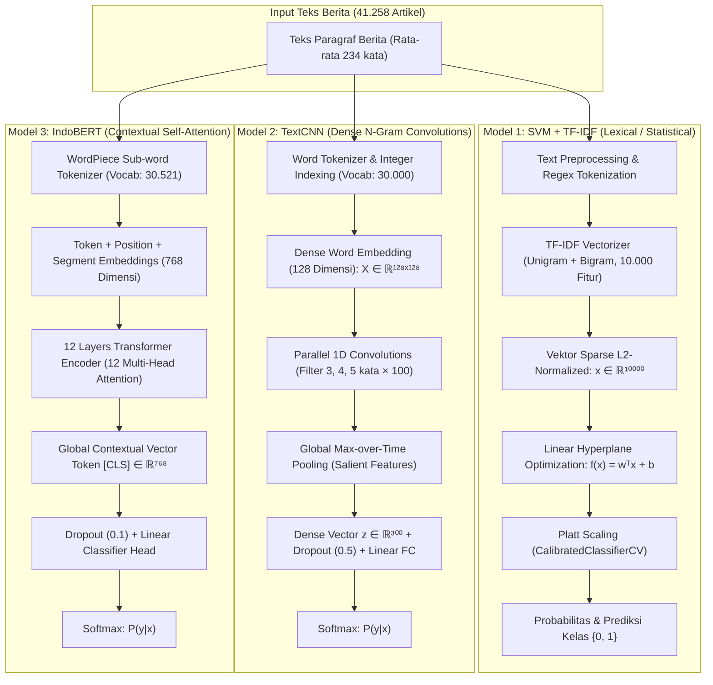
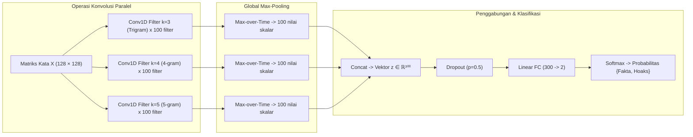

# Analisis Mendalam 3 Paradigma Arsitektur & Mekanisme Pemrosesan Fitur
## Studi Komparasi: Klasifikasi Berita Hoaks & Fakta Bahasa Indonesia
**Target: Naskah Publikasi Jurnal Ilmiah / Bab Pembahasan Tugas Akhir**

Dokumen ini menyajikan analisis komprehensif, terstruktur, dan berbasis formulasi matematis mengenai bagaimana fitur diekstraksi, direpresentasikan, dan diproses oleh 3 paradigma arsitektur berbeda:
1. **Machine Learning Konvensional**: Support Vector Machine (LinearSVC) dengan Pembobotan TF-IDF Unigram & Bigram
2. **Deep Learning**: Convolutional Neural Network untuk Teks (TextCNN - Yoon Kim 2014) dengan Multi-Filter Convolutions
3. **Transformer (Pre-trained Language Model)**: IndoBERT (`indobenchmark/indobert-base-p1`) dengan Bidirectional Multi-Head Self-Attention
4. **Explainable AI (XAI)**: Analisis Atribusi Fitur menggunakan SHAP (*Shapley Additive exPlanations*)

---

## 1. Ringkasan Komparasi Alur Ekstraksi & Pemrosesan Fitur

---

## 2. Model 1: Support Vector Machine (LinearSVC) + TF-IDF

### A. Konsep Dasar & Representasi Fitur
Arsitektur Machine Learning konvensional mengandalkan representasi fitur berbasis frekuensi statistik kata (*lexical statistics*) tanpa mempertimbangkan urutan sintaksis kalimat (*order-independent / Bag-of-Words*).

1. **Pembersihan Teks (*Text Preprocessing*)**:
   Teks dibersihkan melalui fungsi `clean_text`:
   * *Case Folding*: Mengubah seluruh karakter menjadi huruf kecil (*lowercase*).
   * Penghapusan tanda baca, angka, URL, karakter non-alfanumerik menggunakan Regular Expression `\b\w+\b`.
   * Normalisasi *whitespace* ganda menjadi spasi tunggal.

2. **Pembentukan Fitur TF-IDF (Unigram & Bigram)**:
   * **Unigram ($n=1$)**: Mengukur keberadaan kata tunggal (contoh: `"vaksin"`, `"hoaks"`, `"menteri"`).
   * **Bigram ($n=2$)**: Mengukur pasangan dua kata berurutan untuk menangkap konteks lokal (contoh: `"pesan berantai"`, `"bantuan sosial"`, `"surat edaran"`).
   * **Formulasi Sublinear TF**:
     Untuk mencegah dominasi artikel yang sangat panjang, digunakan frekuensi logaritmik (*sublinear scaling*):
     $$TF(t, d) = \begin{cases} 1 + \log(f_{t,d}) & \text{jika } f_{t,d} > 0 \\ 0 & \text{lainnya} \end{cases}$$
   * **Formulasi Inverse Document Frequency (Smooth IDF)**:
     $$IDF(t, D) = \log\left(\frac{1 + |D|}{1 + |\{d \in D : t \in d\}|}\right) + 1$$
     di mana $|D|$ adalah jumlah total dokumen (33.006 data latih), dan penyebut adalah frekuensi dokumen yang memuat kata $t$.
   * **Bobot Akhir & Normalisasi $L_2$**:
     $$TF\text{-}IDF(t, d, D) = TF(t, d) \times IDF(t, D)$$
     $$\mathbf{x} = \frac{\mathbf{v}}{\|\mathbf{v}\|_2} = \frac{\mathbf{v}}{\sqrt{\sum_{i=1}^{V} v_i^2}}$$
     Fitur dibatasi pada **$V = 10.000$ kosakata terpenting** (*max_features* = 10000).

### B. Mekanisme Jalannya Arsitektur SVM
1. **Pencarian *Optimal Separating Hyperplane***:
   Di dalam ruang fitur vektor berdimensi 10.000 ($\mathbb{R}^{10.000}$), LinearSVC memisahkan kelas berita Fakta ($y = -1$) dan Hoaks ($y = +1$) dengan mencari bidang pemisah linier yang memiliki margin terbesar:
   $$\min_{\mathbf{w}, b, \boldsymbol{\xi}} \frac{1}{2}\|\mathbf{w}\|^2 + C \sum_{i=1}^N \xi_i$$
   $$\text{dengan kendala: } y_i (\mathbf{w}^T \mathbf{x}_i + b) \ge 1 - \xi_i, \quad \xi_i \ge 0, \quad \forall i$$
   * $\mathbf{w} \in \mathbb{R}^{10.000}$: Vektor bobot koefisien fitur kata.
   * $b$: Bias skalar.
   * $C = 1.0$: Parameter penalti *soft-margin* yang mengontrol toleransi kesalahan klasifikasi pada data latih.
   * $\xi_i$: Variabel *slack* untuk data yang melanggar margin.

2. **Kalibrasi Probabilitas (*Platt Scaling*)**:
   Karena LinearSVC secara alami hanya menghasilkan jarak margin geometris $f(\mathbf{x}) = \mathbf{w}^T \mathbf{x} + b$ dan bukan probabilitas, model dibungkus dengan `CalibratedClassifierCV(estimator=LinearSVC(), cv=3)`.
   Metode ini memetakan jarak margin ke fungsi sigmoid logistik terkalibrasi:
   $$P(y=1|\mathbf{x}) = \frac{1}{1 + \exp(A \cdot f(\mathbf{x}) + B)}$$
   di mana parameter $A$ dan $B$ dioptimalkan menggunakan *cross-validation* 3-fold.

### C. Kelebihan & Keterbatasan Fitur SVM
* **Kelebihan**: Waktu komputasi pelatihan luar biasa cepat (~3–5 detik untuk 33.006 artikel), kebutuhan memori sangat hemat, dan koefisien bobot $\mathbf{w}$ sangat mudah diinterpretasikan.
* **Keterbatasan**: Tidak memahami urutan kata jangka panjang, tidak memahami sinonim (misal: kata "vaksinasi" dan "imunisasi" dianggap sebagai dua dimensi yang sama sekali tidak berhubungan), serta rentan tertipu oleh teks hoaks yang meminjam istilah formal berita resmi.

---

## 3. Model 2: Deep Learning (TextCNN - Yoon Kim 2014)

### A. Konsep Dasar & Representasi Fitur
TextCNN merevolusi klasifikasi teks dengan memperlakukan matriks kalimat mirip seperti gambar 2D, di mana kata adalah pixel dan konvolusi beroperasi melintasi jendela kata (*n-gram window*).

1. **Tokenisasi Kata & Vocabulary**:
   * Dibangun kamus kosakata (`TextVocab`) dengan batas frekuensi minimal (`min_freq=2`) dan kapasitas maksimum `max_size=30.000`.
   * Token khusus: indeks `0` sebagai `<pad>` (padding) dan `1` sebagai `<unk>` (unknown words).

2. **Lapisan Dense Embedding**:
   Setiap kata dalam sekuens dipetakan menjadi vektor berdimensi padat $d = 128$:
   $$\mathbf{X} \in \mathbb{R}^{L \times d} \quad (L = 128 \text{ panjang sekuens kata}, d = 128 \text{ dimensi embedding})$$
   $$\mathbf{X} = [\mathbf{e}_1, \mathbf{e}_2, \mathbf{e}_3, \dots, \mathbf{e}_L]^T$$
   di mana $\mathbf{e}_i = \text{Embedding}(w_i)$. Vektor embedding ini diperbarui secara adaptif (*trainable*) selama proses *backpropagation*.

### B. Mekanisme Jalannya Operasi Konvolusi & Pooling

1. **Multi-Filter Parallel 1D Convolutions**:
   Model menerapkan 3 set filter paralel dengan ukuran jendela kernel berbeda ($k \in \{3, 4, 5\}$ kata), masing-masing sebanyak $num\_filters = 100$:
   * **Kernel $k=3$**: Menangkap fitur semantik setingkat frasa 3 kata (*trigram*), misalnya `"klaim bantuan dana"`.
   * **Kernel $k=4$**: Menangkap pola 4 kata, misalnya `"beredar pesan berantai di"`.
   * **Kernel $k=5$**: Menangkap pola 5 kata, misalnya `"klik tautan link pendaftaran bansos"`.

   Untuk sebuah filter $j$ dengan bobot $\mathbf{W}^j \in \mathbb{R}^{k \times d}$ dan bias $b^j$, nilai fitur $c_i^j$ pada jendela kata ke-$i$ dihitung sebagai:
   $$c_i^j = \text{ReLU}\left( \sum_{m=0}^{k-1} \mathbf{W}_{m,:}^j \cdot \mathbf{e}_{i+m} + b^j \right)$$
   Operasi ini menghasilkan *feature map* $\mathbf{c}^j = [c_1^j, c_2^j, \dots, c_{L-k+1}^j]^T$.

2. **Global Max-over-Time Pooling**:
   Tantangan utama teks adalah panjang dokumen yang bervariasi dan posisi frasa kunci yang tidak menentu. Solusi TextCNN adalah menerapkan *max-over-time pooling* pada setiap *feature map*:
   $$\hat{c}^j = \max \{ c_1^j, c_2^j, \dots, c_{L-k+1}^j \}$$
   Operasi ini mengekstrak nilai aktivasi tertinggi (*salient feature*) dari filter tersebut, tanpa mempedulikan di posisi mana frasa itu muncul di dalam dokumen (*position invariance*).

3. **Penggabungan Fitur (*Concatenation*) & Fully Connected**:
   Seluruh output pooling dari ke-300 filter digabungkan menjadi satu vektor representasi dokumen:
   $$\mathbf{z} = [\hat{c}_1^3, \dots, \hat{c}_{100}^3, \, \hat{c}_1^4, \dots, \hat{c}_{100}^4, \, \hat{c}_1^5, \dots, \hat{c}_{100}^5]^T \in \mathbb{R}^{300}$$
   Vektor $\mathbf{z}$ dilewatkan melalui regularisasi Dropout ($p=0.5$) untuk mencegah *overfitting*, kemudian diproyeksikan ke 2 kelas output melalui layer linear:
   $$\mathbf{y}_{logits} = \mathbf{W}_{fc} \mathbf{z} + \mathbf{b}_{fc} \in \mathbb{R}^2$$
   Probabilitas kelas dihitung menggunakan fungsi Softmax:
   $$P(y = k | \mathbf{x}) = \frac{\exp(y_{logits, k})}{\sum_{j=0}^1 \exp(y_{logits, j})}$$

---

## 4. Model 3: Transformer (IndoBERT Fine-Tuning)

### A. Konsep Dasar & Representasi Fitur
IndoBERT (`indobenchmark/indobert-base-p1`) mewakili paradigma mutakhir NLP (*Bidirectional Encoder Representations from Transformers*). Berbeda dari SVM dan CNN, IndoBERT menggunakan mekanisme *Self-Attention* yang memungkinkan setiap kata berinteraksi langsung dengan seluruh kata lainnya di dalam teks secara dua arah (*bidirectional*).

1. **Tokenisasi Sub-word WordPiece**:
   Kosakata IndoBERT terdiri atas **30.521 token sub-word**. Kata-kata kompleks bahasa Indonesia yang berimbuhan dipecah menjadi morfom dasar dan prefiks/sufiks:
   * Contoh: `"menindaklanjuti"` $\rightarrow$ `['menindak', '##lanjuti']`
   * Keunggulan: Menyelesaikan masalah *Out-Of-Vocabulary (OOV)* dan mampu mengenali kata-kata slang/typo pada teks hoaks media sosial.

2. **Matriks Input Embedding**:
   Setiap token input diubah menjadi penjumlahan 3 embedding berdimensi $d_{model} = 768$:
   $$\mathbf{E}_i = \mathbf{E}_{token}(w_i) + \mathbf{E}_{position}(i) + \mathbf{E}_{segment}(A) \in \mathbb{R}^{768}$$
   * Token pertama selalu diberi token khusus `[CLS]` (*Classification token*).
   * Token pemisah kalimat diakhiri dengan token `[SEP]`.

### B. Mekanisme Bidirectional Multi-Head Self-Attention
Arsitektur IndoBERT terdiri dari **12 Transformer Encoder Layers**, di mana setiap layer memiliki **12 Attention Heads**.

1. **Scaled Dot-Product Attention**:
   Untuk setiap token $i$, dihitung representasi vektor Query ($\mathbf{Q}$), Key ($\mathbf{K}$), dan Value ($\mathbf{V}$) melalui proyeksi linear:
   $$\mathbf{Q} = \mathbf{H} \mathbf{W}_Q, \quad \mathbf{K} = \mathbf{H} \mathbf{W}_K, \quad \mathbf{V} = \mathbf{H} \mathbf{W}_V$$
   di mana $\mathbf{W}_Q, \mathbf{W}_K, \mathbf{W}_V \in \mathbb{R}^{768 \times 64}$.
   
   Bobot perhatian (*attention weights*) dihitung menggunakan *scaled dot-product*:
   $$\mathbf{A} = \text{softmax}\left( \frac{\mathbf{Q} \mathbf{K}^T}{\sqrt{d_k}} \right) \mathbf{V} \quad (d_k = 64)$$
   Faktor $\frac{1}{\sqrt{d_k}}$ berfungsi sebagai penstabil gradien agar nilai *dot product* tidak menjadi terlalu besar.

2. **Multi-Head Attention**:
   12 head beroperasi secara independen, memungkinkan model secara bersamaan memperhatikan informasi dari aspek berbeda:
   * Head 1–4: Fokus pada hubungan sintaksis (Subjek - Predikat - Objek).
   * Head 5–8: Menangkap entitas bernama (nama tokoh, instansi, lokasi).
   * Head 9–12: Menangkap hubungan retorika klaim vs sanggahan (misalnya korelasi kata `"mengklaim"` dengan kata `"namun tidak terbukti"`).
   $$\text{MHA}(\mathbf{Q}, \mathbf{K}, \mathbf{V}) = \text{Concat}(\text{head}_1, \text{head}_2, \dots, \text{head}_{12}) \mathbf{W}_O$$

3. **Residual Connection & Layer Normalization**:
   Di setiap blok, diterapkan *residual skip-connection* dan normalisasi layer:
   $$\mathbf{Z} = \text{LayerNorm}(\mathbf{H} + \text{MHA}(\mathbf{H}))$$
   $$\mathbf{H}_{out} = \text{LayerNorm}(\mathbf{Z} + \text{FFN}(\mathbf{Z}))$$
   di mana FFN adalah *Feed-Forward Network* 2-layer dengan aktivasi GELU (*Gaussian Error Linear Unit*).

4. **Classification Head pada Token `[CLS]`**:
   Setelah melewati 12 layer encoder, representasi kontekstual dokumen terkumpul secara agregat pada token pertama $\mathbf{h}_{[CLS]} \in \mathbb{R}^{768}$.
   Token ini diteruskan ke *classification head*:
   $$\mathbf{h}_{pooled} = \tanh(\mathbf{W}_{pool} \mathbf{h}_{[CLS]} + \mathbf{b}_{pool})$$
   $$\mathbf{y}_{logits} = \mathbf{W}_{cls} \mathbf{h}_{pooled} + \mathbf{b}_{cls} \in \mathbb{R}^2$$

---

## 5. Ringkasan Perbandingan Teknis Fitur Antar Arsitektur

| Parameter / Karakteristik | SVM (LinearSVC) | TextCNN (Yoon Kim) | IndoBERT (Transformer) |
| :--- | :--- | :--- | :--- |
| **Bentuk Representasi Fitur** | Vektor Sparse Berdimensi Tinggi ($\mathbb{R}^{10.000}$) | Matriks Dense Embedding ($\mathbb{R}^{128 \times 128}$) | Sekuens Vektor Kontekstual Dinamis ($\mathbb{R}^{128 \times 768}$) |
| **Metode Ekstraksi Fitur** | Pembobotan Statistik TF-IDF (Unigram + Bigram) | Multi-kernel Konvolusi 1D ($k=3, 4, 5$) | Multi-Head Self-Attention (12 Heads, 12 Layers) |
| **Sensitivitas Urutan Kata** | Tidak peka (*Order-Independent*) | Peka pada frasa lokal (3–5 kata) | Peka penuh secara dua arah (*Full Bidirectional*) |
| **Penanganan Kosakata Baru (OOV)** | Diabaikan / Dibuang (*Ignored*) | Diberi token khusus `<unk>` | Dipecah menjadi sub-word (WordPiece) |
| **Kebutuhan Komputasi (Latih)** | Sangat Rendah (~3–5 detik, CPU/GPU) | Sedang (~1–2 menit pada RTX 3050) | Tinggi (~15–18 menit pada RTX 3050 GPU) |
| **Akurasi & Macro F1 (Data 35k–41k)** | Akurasi: ~97,53% \| F1: 97,20% | Akurasi: ~96,94% \| F1: 96,50% | **Akurasi: 98,61% \| F1: 98,42% (Tertinggi)** |
| **Kemampuan Generalisasi** | Mengandalkan kata kunci spesifik | Mengenali pola frasa hoaks | Memahami konteks dan gaya bahasa berita |

---

## 6. Analisis Atribusi Fitur dengan Explainable AI (SHAP)

Untuk menjawab pertanyaan mengenai **"seperti apa jalannya fitur dalam memengaruhi keputusan model"**, proyek ini mengimplementasikan **SHAP (Shapley Additive exPlanations)** yang berbasis teori permainan (*cooperative game theory*).

### A. Teori Dasar Shapley Value pada Teks
Nilai Shapley $\phi_i$ mengukur kontribusi marjinal rata-rata dari sebuah fitur kata $i$ terhadap output prediksi model di seluruh kemungkinan kombinasi himpunan kata $S$:
$$\phi_i(f, \mathbf{x}) = \sum_{S \subseteq F \setminus \{i\}} \frac{|S|!(|F| - |S| - 1)!}{|F|!} \left[ f(S \cup \{i\}) - f(S) \right]$$

### B. Temuan Atribusi Fitur pada Masing-Masing Model
Berdasarkan visualisasi SHAP yang tersimpan di direktori `results/`:

1. **Atribusi Fitur pada SVM (`results/shap_svm.png`)**:
   * Fitur dengan bobot koefisien positif terbesar ($\phi_i > 0$, pemicu prediksi **Hoaks**): kata-kata sensasional dan imbauan khas pesan berantai, seperti `"pesan berantai"`, `"tautan"`, `"pendaftaran"`, `"waspada"`, `"sebar"`.
   * Fitur dengan bobot koefisien negatif ($\phi_i < 0$, pemicu prediksi **Fakta**): kata-kata institusional dan kutipan formal, seperti `"menteri"`, `"dikonfirmasi"`, `"kapolri"`, `"resmi"`, `"kabupaten"`.

2. **Atribusi Fitur pada TextCNN (`results/shap_textcnn.png`)**:
   * Filter konvolusi mengidentifikasi potongan frasa kunci. Nilai SHAP tertinggi terkonsentrasi pada gabungan kata seperti `"bantuan sosial cair"` atau `"isu yang beredar"`.

3. **Atribusi Fitur pada IndoBERT (`results/shap_indobert.png` & `waterfall`)**:
   * IndoBERT menunjukkan atribusi paling kontekstual. Kata `"anies"` atau `"menteri"` tidak otomatis dianggap fakta atau hoaks secara kaku, melainkan dinilai berdasarkan kata kerja yang menyertainya (misalnya jika didampingi kata `"menghadiri acara milad"` $\rightarrow$ bernilai fakta; jika didampingi `"ditangkap karena"` tanpa sumber kredibel $\rightarrow$ menggeser prediksi ke arah hoaks).

